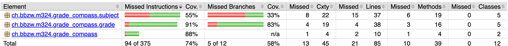

1.4:
CreateSubjectRequestTest = Unit Test ->  Nur ein Validator direkt instanziiert, testet die Validierungs-Constraints eines einzelnen DTOs isoliert.
SubjectServiceTest = Unit Test -> Mockt Servcie und Repo
GradeServiceTest = Unit Test -> Mocks, @InjectMocks & MockitoExtention
SubjectControllerTest = Controller Test ->  @WebMvcTest(SubjectController.class) lädt nur die Web-Schicht (lädt also einen minimalen, gezielt reduzierten Spring-Kontext). Der Service ist @MockitoBean (gemockt), getestet wird über MockMvc nur HTTP-Request-Mapping, Validierung, Statuscodes.
SubjectRepositoryTest = Repository Test -> @DataJpaTest konfiguriert nur die JPA/Datenbank-Schicht (in-memory DB, Transaktionen, Rollback nach jedem Test). SubjectRepository wird real @Autowired, getestet werden Queries/Constraints gegen eine echte DB.
SubjectIntegrationTest = Int Test ->  @SpringBootTest + @AutoConfigureMockMvc lädt den gesamten Anwendungskontext (Controller → Service → Repository → DB), nichts ist gemockt. Testet  den kompletten Weg von HTTP-Request bis zur Datenbank.
GradeCompassApplicationTests = Int Test -> @SpringBootTest ohne weitere Einschränkung — lädt den vollen Kontext nur um zu prüfen, ob die App überhaupt startet (contextLoads()).

2.2:

2.3
Nicht testete methoden: 
Subject Service: delete(), update()
Subject Controller: delete(), update()